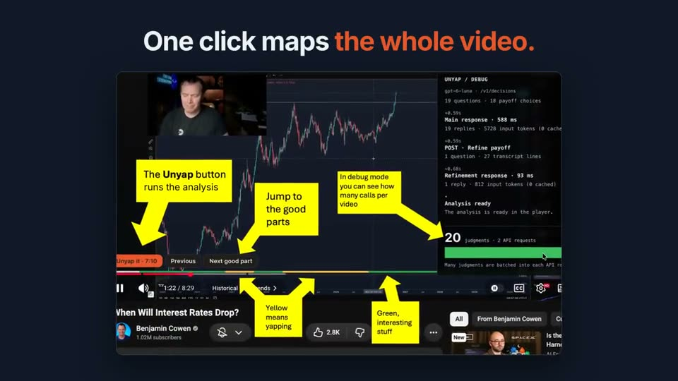

# Unyap

**Impatience, now a browser extension.**

You clicked for the answer, not ten minutes of intro. Unyap is a Chrome
extension that reads a YouTube video's captions, finds where it actually
delivers what its title promised, and jumps there. A strip above the progress
bar marks filler, context and substance; **Previous** and **Next good part**
skip between useful sections. If the title never pays off, Unyap says so.

### See it in 17 seconds

Click the preview to play the silent walkthrough. The UI footage is from the
[original demo](https://giuseppe.dev/unyap/); the setup card reflects the newer
OpenAI **and** OpenRouter options.

## Why a Decisions API?

Instead of asking a chat model to write a summary and hoping to parse it,
Unyap asks a decision model structured questions about the title and transcript:
**does the video deliver, which segment first gives the answer, and how much of
each segment is substance?** One batched Decisions API call returns the
judgments and probabilities; a second, smaller call finds the exact transcript
line to jump to. That gives the progress strip and jump buttons a concrete
answer to act on, rather than a wall of generated text.

- **Pick your model, not my vendor.** Use [OpenAI's Decisions API](docs/decisions-api.md)
  directly, or bring an [OpenRouter](https://openrouter.ai) key and choose from
  the decision models offered in the options page (including models from
  different publishers). The model list is curated for transcript-sized
  context, not locked to one company. Change provider or model in the options.
- **Your key, your browser.** Analysis runs in the extension; there is no Unyap
  server or account. Your key and the video's text go to the provider you pick
  (with OpenRouter, also to the model provider). Nothing goes to me. Private and
  unlisted videos are skipped. Results are cached locally for 60 days, so
  revisiting a video doesn't call the model again. OpenAI costs roughly $0.001
  per new video; OpenRouter pricing depends on the model and video length.
  [Privacy policy](https://giuseppe.dev/unyap/privacy/).
- **Open source, all the way down.** The extension and analysis pipeline are
  [MIT licensed](LICENSE). Read the prompts, change the model integration,
  fork it, or build your own version. No hosted Unyap service to depend on.

You run Unyap with your own key, at your own responsibility and cost; it comes
as is, without warranty. [Terms of use](https://giuseppe.dev/unyap/terms/).

## Install

1. Get it from the [Chrome Web Store](https://chromewebstore.google.com/detail/unyap/jbmhegfmbdlkpiilfnjpmdkflfooobfe).
2. In the options page, choose **OpenAI** and paste your OpenAI key, or choose
   **OpenRouter**, pick a decision model and paste your OpenRouter key. Save.
3. Open a public YouTube video with captions and click **Unyap this video**.
   Use **Unyap it** to jump to the answer or **Next good part** to skip ahead.

**Debug mode** (in the options): a panel over the player shows each Decisions
API request, its timing and token counts, and the judgment progress. Save, then
refresh the YouTube tab.

## Build from source

1. `npm ci && npm run build` (Node 24 or later).
2. Open `chrome://extensions`, turn on Developer mode, choose **Load unpacked**
   and select `extension/dist`. To update, rebuild, click the extension's reload
   button and refresh your YouTube tabs.

`npm run check` runs the type check, the unit tests and the build; `npm run e2e`
runs the Playwright tests. [AGENTS.md](AGENTS.md) describes the layout, the
conventions and how the analysis works.

## License

[MIT](LICENSE). Fork and adapt it however you like. More on the
[home page](https://giuseppe.dev/unyap/).
